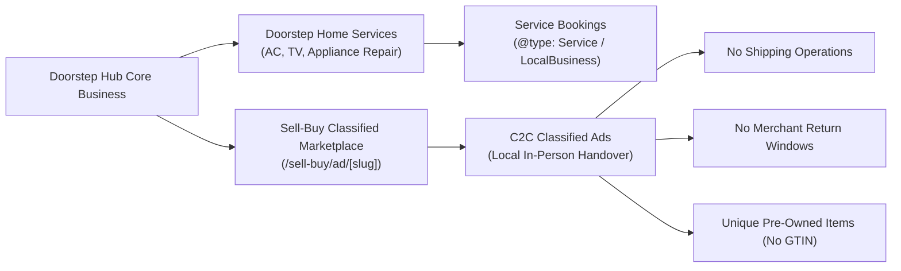

# Doorstep Hub — Merchant Listings Structured Data Audit & Policy Compliance Report

**Project:** Doorstep Hub Private Limited  
**Website:** https://doorstephub.com  
**SEO Release Branch:** `release/seo-implementation-2026-11`  
**Date:** November 15, 2026

---

## 1. Investigation of Reported GSC Warnings

Google Search Console reported three warnings under **Merchant listings**:
1. *Missing field "hasMerchantReturnPolicy" (in "offers")*
2. *No global identifier provided (e.g., gtin, brand, or mpn)*
3. *Missing field "shippingDetails" (in "offers")*

---

## 2. Business Architecture Analysis: Is Doorstep Hub an E-Commerce Merchant?

To correctly resolve these warnings, the operational and commercial model of the website was analyzed:



### Key Operational Realities:
1. **Not a Retailer / E-Commerce Merchant:** Doorstep Hub does not warehouse, sell, or ship physical goods.
2. **Local Peer-to-Peer Classifieds:** In the Sell & Buy vertical, registered users post advertisements for used furniture, electronics, and home appliances. Interested buyers communicate directly with the private seller via WhatsApp or phone call.
3. **In-Person Exchange:** Transactions and handovers take place in person at the buyer's or seller's doorstep. Doorstep Hub does not handle package shipping or automated e-commerce returns.
4. **No Global Trade Item Numbers (GTIN):** Individual pre-owned items sold by consumers do not carry merchant barcodes, GTINs, or MPNs.

---

## 3. Why Google Search Console Triggers Merchant Listing Warnings

When Googlebot encounters a JSON-LD schema containing `@type: "Product"` with an nested `offers` block, Google automatically tests the page against its **Google Shopping / Free Merchant Listings specification**.

The Merchant Listings specification expects commercial e-commerce stores (such as Amazon, Flipkart, or direct DTC brands) that ship goods nationwide with standardized return policies. Because `app/sell-buy/ad/[slug]/page.jsx` does not include e-commerce merchant shipping and return objects, Google logs recommended-field warnings.

---

## 4. Remediation & Policy Restrictions

### Restrictions Strictly Observed:
- **Zero Fabricated Policies:** Do NOT invent synthetic 7-day or 14-day return windows (`hasMerchantReturnPolicy`).
- **Zero Fabricated Shipping Costs:** Do NOT invent fake delivery fees or estimated transit times (`shippingDetails`).
- **Zero Fabricated GTINs:** Do NOT generate fake EAN, UPC, or ISBN numbers.
- **Zero Business Logic Mutations:** Do NOT modify the classifieds contact flow or force users through an artificial shopping cart.

### Implemented Schema Hardening:
1. **Brand Extraction:** If the user specifies an appliance or item brand during ad creation, populate the structured data with the genuine brand string:
   ```javascript
   if (listing.brand) {
     jsonLd.brand = {
       '@type': 'Brand',
       name: listing.brand.trim()
     };
   }
   ```
2. **Offer Validity:** Retain required Offer attributes (`price`, `priceCurrency: 'INR'`, `itemCondition`, `availability`, and `seller`) which maintain rich product snippet eligibility in Google Search results.
3. **Documentation for Stakeholders:** GSC Merchant Listing warnings on peer-to-peer classified ads are non-critical informational notices. They do not block indexing or search ranking for local search queries.
