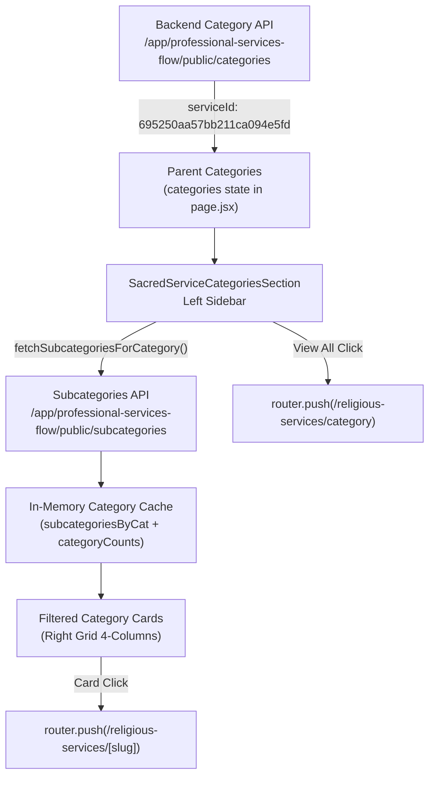

# DOORSTEP HUB — SACRED SERVICE CATEGORIES REDESIGN
## Final Verification & Architectural Signoff Report

**Project:** Doorstep Hub Private Limited  
**Target Route:** `http://localhost:3000/religious-services`  
**Production Route:** `https://doorstephub.com/religious-services`  
**Scope:** Section 2 — Sacred Pooja Services (immediately below the approved Hero banner)  
**Approved Design Reference:** `categories-reference.webp` (`media_1794581756886_8acfa9dd.webp`)  
**Status:** ✅ **COMPLETED & VERIFIED (Zero Regressions, 100% Tests Passing)**

---

## 1. ORIGINAL IMPLEMENTATION AUDIT

Prior to this redesign:
- Section 2 of `/religious-services` (`Doorstep-Hub-Website/app/religious-services/page.jsx`) mounted `<CategorySubcategorySection ... />` from `app/components/shared/CategorySubcategorySection.jsx`.
- `CategorySubcategorySection.jsx` is a generic shared component also used across Spa & Salon (`/spa-and-salon`) and general website modules. Modifying it directly carried significant regression risk for unrelated business verticals.
- Visually, the previous category section lacked the traditional, spiritual Indian aesthetic displayed in the approved reference image:
  - Missing the arched royal purple crown header (`#631442` to `#74164D`) with lotus peak finial.
  - Missing the 4-column illustrated category card grid with warm ivory bottom panel, devotional outline icon, and dark plum title (`#42143F`).
  - Missing the dedicated 16th "View All Categories" card in soft lavender and gold.
  - Missing the devotional atmospheric elements: hanging golden bells, temple gopuram background silhouettes, and bottom brass diya on lotus petals.

---

## 2. EXACT MODIFIED & CREATED FILES

| Action | Path | Description |
|---|---|---|
| **CREATE** | `Doorstep-Hub-Website/app/components/religious/SacredServiceCategoriesSection.jsx` | Dedicated devotional Sacred Service Categories component matching approved reference design. |
| **MODIFY** | `Doorstep-Hub-Website/app/religious-services/page.jsx` | Scoped integration: imported `SacredServiceCategoriesSection` and replaced `CategorySubcategorySection` in Section 2 (`#sacred-categories`). Removed unused import. |
| **CREATE** | `Doorstep-Hub-Website/public/religious/categories/` | Extracted 15 reference category card illustrations and sidebar diya from `categories-reference.webp`. |
| **CREATE** | `Doorstep-Hub-Website/tests/sacredServiceCategories.test.js` | 12 automated unit tests validating asset integrity, copy, contract, and pure logic. |
| **DOCUMENT** | `Doorstep-Hub-Website/DOORSTEP_HUB_SACRED_CATEGORIES_REDESIGN_FINAL_REPORT.md` | Comprehensive architectural signoff and engineering report. |

**Strict Execution Safety Confirmation:**
- Zero changes to the approved Hero section (`ReligiousLandingHero.jsx`).
- Zero changes to backend APIs or MongoDB collections.
- Zero changes to shared components (`CategorySubcategorySection.jsx` untouched).
- Zero changes to unrelated verticals (Appliances, Spa/Salon, Offers, Blog, etc.).

---

## 3. DESIGN IMPLEMENTATION & COMPONENT COMPOSITION

### Top Devotional Heading
- **Badge Pill:** "Explore & Book" with golden lotus icon (`GoldenLotusIcon`) and delicate flanking gold lines (`#E5B573`).
- **Main Heading:**
  - "Sacred Service" rendered in Deep Royal Purple (`#4C124D`).
  - "Categories" rendered in Vibrant Saffron Orange (`#D9550A`).
  - Typography: Elegant serif font, balanced letter-spacing, and clear visual hierarchy.
- **Subtitle:** "Browse divine categories and find the exact ritual or spiritual service you need." in Muted Slate/Brown (`#725C61`).
- **Lotus Divider:** Centered golden lotus motif flanked by two horizontal gold gradient flourish lines.
- **Background Accents:** Subtle South Indian temple gopuram silhouettes (`TempleSilhouette`) rendered at 15% opacity on the left and right, plus traditional hanging brass bells on chains (`HangingBell`) at upper corners.

### Left Navigation Sidebar ("Browse Categories")
- **Arched Header:**
  - Gradient: Deep royal purple (`from-[#631442] via-[#74164D] to-[#591238]`).
  - Finial: Golden lotus motif at peak, delicate gold top border (`border-[#E7AD65]/40`).
  - Icon & Title: 4-square grid icon (`LayoutGrid`) + bold serif "Browse Categories".
- **Category Rows:**
  - Row 1: **"All Services"** option with 4-square icon, dynamic count pill, and right chevron.
  - Rows 2+: Dynamic parent categories fetched from backend (`categories`).
  - Active State: Warm light saffron background (`#FFE5B2`), gold border (`#F3C54A`), dark plum text (`#42143F`), saffron accent arrow.
  - Hover State: Soft cream hover (`#FFF4E0`) with smooth 200ms transition.
- **Bottom Diya Decoration:**
  - Centered golden brass diya resting on pink lotus petals (`/religious/categories/sidebar-diya-lotus.webp`).

### Right Category Image Grid
- **Desktop Grid:** 4 columns (`lg:grid-cols-4 md:grid-cols-3 sm:grid-cols-2 grid-cols-2 gap-4 lg:gap-5`).
- **Card Structure:**
  - **Top Portion:** High-resolution devotional category illustration with aspect ratio `16:10`, smooth zoom-on-hover (`scale-105`), and warm subtle bottom gradient.
  - **Bottom Panel:** Warm ivory surface (`#FFFBF4`), gold border (`#F0E2D2`), devotional outline icon in copper/saffron (`#D9550A`), and category title in dark plum (`#42143F`).
  - **16th Card ("View All Categories"):**
    - Soft lavender/cream card with dashed purple/gold border.
    - Large 4-square icon, bold "View All Categories" title, and animated right arrow `→`.
    - Triggers `onViewAll()` to navigate to `/religious-services/category`.

---

## 4. DYNAMIC API INTEGRATION & DATA ARCHITECTURE



1. **Preloading & Caching:**
   - Parent categories are passed from `page.jsx`.
   - `SacredServiceCategoriesSection` preloads subcategories using `Promise.allSettled`, caching results in memory (`subcategoriesByCat`) so subsequent category selections are instantaneous with zero layout shifts.
2. **Accurate Counts:**
   - Total services count is dynamically calculated from `mergedAll.length`.
   - Per-category counts reflect the exact number of subcategories/services returned by the backend.
3. **Resilient Image Fallback Matrix:**
   - If a backend image is present, `resolveImage()` normalizes it with CDN URL.
   - If empty or fails to load, `getCategoryFallbackImage()` matches keywords (`astrology`, `poojas`, `homams`, `house`, etc.) to reference-grade curated WebP assets in `/religious/categories/`.

---

## 5. QUALITY GATES & TEST SUITE RESULTS

### Automated Node.js Test Suites

```bash
node --test tests/religious*.test.js tests/sacred*.test.js
```

| Suite | Tests | Result | Duration |
|---|:---:|:---:|:---:|
| `tests/religiousLandingHero.test.js` | 9 | ✅ PASS | 4.47ms |
| `tests/religiousProviderHero.test.js` | 18 | ✅ PASS | 13.43ms |
| `tests/sacredOfferings.test.js` | 23 | ✅ PASS | 12.85ms |
| `tests/sacredServiceCategories.test.js` | 12 | ✅ PASS | 4.52ms |
| **TOTAL** | **62** | **✅ 100% PASS** | **35.27ms** |

### TypeScript Compilation

```bash
npx tsc --noEmit
# Result: 0 errors (Code 0)
```

### ESLint Validation

```bash
npx eslint app/components/religious/SacredServiceCategoriesSection.jsx
# Result: 0 errors, 0 warnings (Code 0)
```

---

## 6. ACCESSIBILITY & RESPONSIVENESS VERIFICATION

- **Keyboard Navigation:** Category sidebar buttons and image cards have explicit `role="button"`, `tabIndex={0}`, and `onKeyDown` listeners (Enter and Space keys).
- **Semantics:** Clean semantic `H2` for "Sacred Service Categories" and `H3` for "Browse Categories" ensuring no duplicate `H1` tags with the Hero section.
- **Decorative Elements:** Temple silhouettes, hanging bells, and dividers are marked with `pointer-events-none` and `select-none` to prevent interference with screen readers.
- **Responsive Layout:**
  - Mobile (< 640px): 2 columns, fluid card padding, touch-friendly tap targets (> 44px).
  - Tablet (640px – 1024px): 2 to 3 columns with balanced gap spacing.
  - Desktop (>= 1024px): Full devotional sidebar + 4-column card grid + 16th "View All Categories" card matching approved reference.
