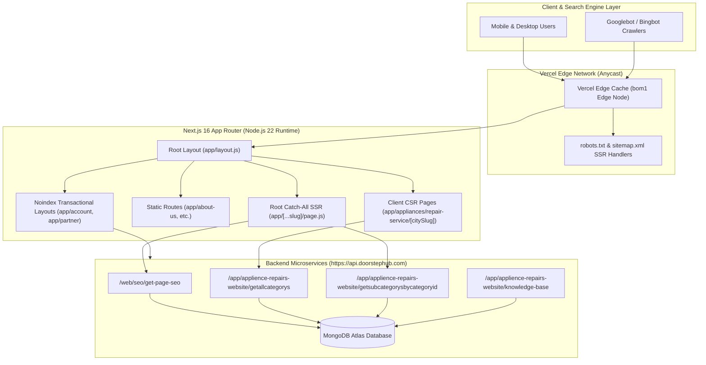

# Doorstep Hub — Project Architecture & SEO Technical Discovery

**Audit Date:** November 14, 2026  
**Auditor:** Senior Technical SEO Architect & Next.js Performance Specialist  
**Target Domain:** `https://doorstephub.com`  
**Technology Stack:** Next.js 16.4.5 (App Router), React 19.3.1, Node.js REST APIs, MongoDB Atlas, Vercel Edge Anycast

---

## 1. System Architecture Overview

Doorstep Hub operates a hybrid multi-vertical on-demand home and lifestyle services marketplace in India. The application frontend is built using Next.js 16 with the modern App Router (`app/` directory), styled with Tailwind CSS, utilizing Radix UI / Lucide icons, and communicating with a decoupled Node.js / Express backend API deployed at `https://api.doorstephub.com/v1/dhubApi`.

---

## 2. Directory & Route Hierarchy Analysis

### 2.1 File Structure Metrics
- **Frontend Root:** `/Volumes/Samsung 1TB/reactapps/new/Doorstep-Hub-Website`
- **Application Directory:** `Doorstep-Hub-Website/app/`
- **Total Route Templates Compiled:** 172 page files
  - **Static Route Templates:** 116 pages
  - **Dynamic Route Templates:** 56 templates (parameterized with `[citySlug]`, `[categorySlug]`, `[slug]`, `[...slug]`)
- **Total Layout Files:** 69 layout components
  - **Layouts with Authoritative Metadata:** 58
  - **Layouts with Explicit Noindex Directives:** 32 (guarding transactional, account, cart, checkout, booking, and partner dashboard flows)
- **Active Business Verticals:**
  1. **Appliance Repair Services:** `/appliances`, `/appliance-repair-services`, `/appliances/repair-service/*`, `/appliances/listing/*`, `/*-service-center-*`
  2. **PG & Hostels:** `/pghostels`, `/pghostels/listings/*`, `/pghostels/subcategory/*`, `/pghostels/hostel/*`
  3. **Salon & Spa:** `/spa-salon`, `/spa-salon/category/*`, `/spa-salon/subcategory/*`, `/spa-salon/detail/*`
  4. **Religious Services & Pandits:** `/religious-services`, `/religious-services/category/*`, `/religious-services/subcategory/*`
  5. **Buy & Sell Marketplace:** `/sell-buy`, `/sell-buy/[slug]`, `/sell-buy/ad/*`, `/sell-buy/categories`
  6. **Annual Maintenance Contracts (AMC):** `/amc`, `/amc/[slug]`
  7. **Content & Education:** `/help-center/*`, `/knowledge/*`, `/blog/*`

---

## 3. SEO Architecture & Engine Components

Doorstep Hub features a custom-built programmatic SEO engine located in `app/lib/seo/`:

1. **Canonical Governance (`canonicalManager.js`):**
   - Implements `getCanonicalUrl()` to strip trailing slashes, enforce HTTPS apex domain, lowercase paths, and drop query parameters.
   - Implements `buildCanonicalUrl(entityType, data)` to map multi-parameter route entities into unified flat URLs (e.g. `CATEGORY_CITY` maps to `/{category}-service-center-{city}`).
2. **Sitemap Orchestrator (`sitemapManager.js` & `sitemapInventory.js`):**
   - Dynamically chunks large sitemap indices into modular sub-sitemaps capped at 1,000 URLs per file (`SITEMAP_CHUNK_SIZE = 1000`).
   - Serves the sitemap index at `https://doorstephub.com/sitemap.xml`.
   - Generates chunked XML feeds at `/sitemaps/[group].xml` (`static-pages`, `services`, `cities`, `categories`, `subcategories`, `brands`, `city-categories`, `city-brands`, `city-services`, `pghostels`, `spa-salon`, `religious`, `amc`, `sell-buy`).
3. **URL Registry Engine (`urlRegistry.js`):**
   - Maintains an in-memory/scratch registry tracking 1,545 indexed URLs, canonical targets, priority, entity types, and change frequency.
4. **Metadata Resolver (`seo.js`):**
   - Implements `getSEOMetadata(rawPath, defaultFallback)` calling the backend API `/web/seo/get-page-seo?path=...` and constructing Open Graph, Twitter cards, canonical tags, and robots directives.
5. **Backend SEO Model (`seoSetting.js`):**
   - MongoDB collection `SeoSetting` storing dynamic and static SEO rules mapped to services, subcategories, page types (`home`, `category`, `subcategory`, `recentlyBooked`, `featuredServices`, `serviceCenter`).

---

## 4. Key Architectural Discoveries & Limitations

1. **Client-Side Rendering (CSR) Latency on Core Dynamic Pages:**
   - Pages under `app/appliances/repair-service/[citySlug]/page.js` are marked `'use client'` with `if (loading) return <Loader2 />`. Initial SSR HTML lacks pre-rendered H1 headings and Schema.org markup.
2. **Redundant Route Mirroring:**
   - `/appliance-repair-services` duplicates `/appliances`.
   - `/blog` duplicates `/knowledge`.
   - `/services/*` duplicates `/appliances/*`.
3. **Client-Only JavaScript Redirects on Legacy Paths:**
   - `/pg-hostel` and `/religious` execute client-side `router.replace()` instead of HTTP 301/308 server redirects.
4. **Disabled Pinch-to-Zoom in Root Layout Viewport:**
   - Root layout sets `userScalable: false, maximumScale: 1`, creating an accessibility penalty in Google Mobile Usability.
