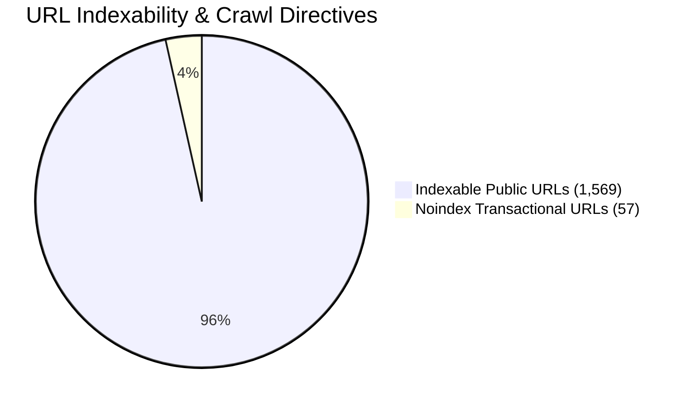

# Doorstep Hub — Complete Website URL Inventory Report

**Total Discovered URLs Across All Sources:** 1,626 URLs  
**Total Dynamic Sitemap Registry URLs:** 1,545 URLs  
**Total Static Filesystem Routes:** 116 routes  
**Total Dynamic Route Templates:** 56 templates  
**Verified Indexable Public URLs:** 1,569 URLs  
**Protected Noindex / Private URLs:** 57 URLs  

---

## 1. High-Level Inventory Breakdown

| Classification | Count | Percentage | Primary Status | Description |
|---|---|---|---|---|
| **Dynamic City-Brand Pages** | 962 | 59.2% | Indexable (200 OK) | Combinatorial brand + city pages (e.g. `/ao-smith-.../bengaluru`) |
| **Dynamic City-Category Pages** | 208 | 12.8% | Indexable (200 OK) | Localized core service pages (e.g. `/ac-repair-service-center-hyderabad`) |
| **Dynamic City-Service Pages** | 130 | 8.0% | Indexable (200 OK) | Nearby local service discovery (`/nearby/{service}/{city}`) |
| **Static Public Pages** | 59 | 3.6% | Indexable (200 OK) | Corporate, Legal, Category hubs, Help Center, Blog, Knowledge |
| **Static Protected / Private Pages**| 57 | 3.5% | Noindex (200 OK) | Customer Account, Partner Portal, Cart, Checkout, Deletion |
| **Buy & Sell Marketplace URLs** | 40 | 2.5% | Indexable (200 OK) | Marketplace category landing pages and public ads |
| **Appliance Brand Hubs** | 37 | 2.3% | Indexable (200 OK) | Nationwide brand repair landing pages |
| **PG & Hostel Subcategory Pages** | 37 | 2.3% | Indexable (200 OK) | Localized PG room type bookings |
| **Operational City Hubs** | 26 | 1.6% | Indexable (200 OK) | Appliance repair city hub directories |
| **Appliance Subcategories** | 23 | 1.4% | Indexable (200 OK) | Specific appliance repair procedures (Split AC, Cassette AC) |
| **PG & Hostel Category Hubs** | 13 | 0.8% | Indexable (200 OK) | Boys PG, Girls PG, Coliving accommodation |
| **Core Appliance Categories** | 8 | 0.5% | Indexable (200 OK) | AC, Refrigerator, Washing Machine, TV, Microwave, Geyser |
| **PG Listing Hubs** | 8 | 0.5% | Indexable (200 OK) | Professional hostel discovery |
| **Spa & Salon Category Hubs** | 5 | 0.3% | Indexable (200 OK) | Facial, Hair care, Massage, Waxing, Makeup |
| **Religious Service Hubs** | 5 | 0.3% | Indexable (200 OK) | Griha Pravesh, Satyanarayan Puja, Rudrabhishek |
| **Core Services Directory** | 4 | 0.2% | Indexable (200 OK) | Main service directory hubs |
| **AMC Maintenance Plans** | 2 | 0.1% | Indexable (200 OK) | AC Maintenance, Home Appliances AMC |
| **Client-Redirected Legacy Routes** | 2 | 0.1% | Soft Redirect (200 OK)| `/pg-hostel` -> `/pghostels`, `/religious` -> `/religious-services` |
| **Duplicate Core Landing Pages** | 1 | 0.1% | Duplicate (200 OK) | `/appliance-repair-services` duplicates `/appliances` |

---

## 2. Status & Indexability Summary

### 2.1 Indexable Public URLs (1,569)
- Fully accessible via `robots.txt` (`Allow: /`).
- Server-rendered with `<meta name="robots" content="index, follow" />`.
- Tracked in `02_COMPLETE_URL_INVENTORY.csv` and submitted via XML sitemaps.

### 2.2 Noindex Protected URLs (57)
- Authenticated account management (`/account/bookings`, `/account/profile`, `/account/wallet`, `/account/support`).
- Service partner business portal (`/partner/dashboard/*`, `/partner/dashboard/kyc`, `/partner/dashboard/subscription`).
- Transactional checkout flows (`/appliances/cart`, `/appliances/checkout`, `/services/payment-failed`, `/services/thank-you`).
- Explicitly protected with `<meta name="robots" content="noindex, nofollow" />` in layout files.

---

## 3. Reconciliation Between Sources

1. **Codebase Filesystem vs Sitemap Registry:**
   - 36 static routes match 1:1 with sitemap entries.
   - 57 static routes are properly excluded as transactional/noindex routes.
   - 23 static routes are currently omitted from sitemaps (including `/appliance-repair-services`, `/service-partner`, `/offers`, `/app`).
2. **Sitemap Index Chunking:**
   - `sitemap.xml` properly delegates 1,545 URLs into 16 modular XML chunks, ensuring sub-50,000 URL per file compliance.
