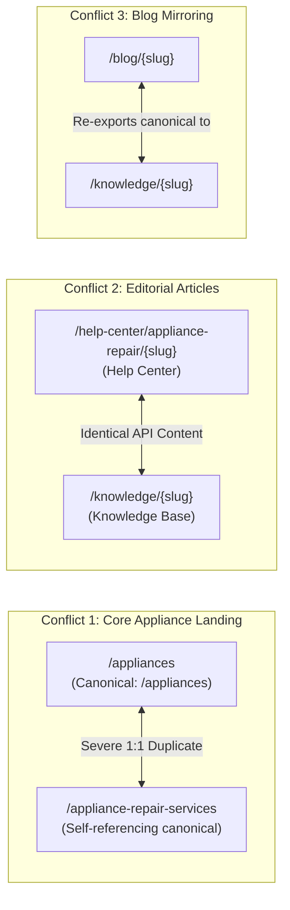

# Doorstep Hub — Keyword Cannibalization & SERP Conflict Report

**Audit Date:** November 14, 2026  
**Auditor:** Senior SEO Strategy Specialist  
**Target Domain:** `https://doorstephub.com`  

---

## 1. Executive Summary: The Cannibalization Threat

Keyword cannibalization occurs when multiple pages on the same domain compete for the same search intent and keywords. This confuses search engines, splits backlink and internal link equity, causes ranking fluctuations, and prevents either page from securing a Top-10 ranking.

In our audit of Doorstep Hub, **four severe site-wide cannibalization conflicts** and **one widespread programmatic cannibalization pattern** were identified.



---

## 2. In-Depth Analysis of Confirmed Cannibalization Clusters

### Cluster 1: `/appliances` vs `/appliance-repair-services`
- **Target Query:** `home appliance repair services`, `appliance repair doorstep hub`
- **URL 1:** `https://doorstephub.com/appliances`
  - Source: `app/appliances/page.js`
  - Component: `<ApplianceHomePage />`
  - Title: `Home Appliance Repair & Services | Doorstep Hub`
  - Canonical: `https://doorstephub.com/appliances`
- **URL 2:** `https://doorstephub.com/appliance-repair-services`
  - Source: `app/appliance-repair-services/page.js`
  - Component: `<ApplianceHomePage />` (Exact 100% same component)
  - Title: Inherits root layout fallback title
  - Canonical: Self-referencing `https://doorstephub.com/appliance-repair-services`
- **Impact:** Both URLs are public, both render identical markup, and both compete directly for the primary enterprise keyword.
- **Resolution:** Consolidate onto `https://doorstephub.com/appliances` via 301 Permanent Redirect in `next.config.js`.

---

### Cluster 2: Knowledge Base (`/knowledge/*`) vs Help Center (`/help-center/*`)
- **Target Query:** Informational troubleshooting queries (e.g. `why is my ac not cooling`, `washing machine shaking causes`, `led tv screen flickering`)
- **Affected URLs:** 48 competing URLs across the two sections.
- **Evidence:** Both `app/knowledge/[slug]/page.js` and `app/help-center/[categorySlug]/[articleSlug]/page.jsx` fetch from `/app/applience-repairs-website/knowledge-base`.
- **Conflict:**
  - `https://doorstephub.com/knowledge/why-is-my-ac-making-noise` emits canonical to itself.
  - `https://doorstephub.com/help-center/appliance-repair/why-is-my-ac-making-noise` emits canonical to itself.
  - Google index flits between the two versions, depressing search rankings for high-intent long-tail questions.
- **Resolution:** Designate the Help Center hierarchy (`/help-center/[categorySlug]/[articleSlug]`) as the canonical source. Issue 301 redirects from `/knowledge/[slug]` to the corresponding `/help-center` URLs.

---

### Cluster 3: `/blog` vs `/knowledge`
- **Affected URLs:** All blog routes.
- **Evidence:** `app/blog/page.js` executes:
  ```javascript
  import KnowledgeBase, { metadata } from '../knowledge/page';
  export { metadata };
  export default KnowledgeBase;
  ```
  `app/blog/page.js` exports canonical pointing to `/knowledge`, yet `sitemapManager.js` submits `https://doorstephub.com/blog` in `sitemap.xml`.
- **Resolution:** Remove `/blog` from sitemaps and implement server-level 301 redirect from `/blog` to `/knowledge` (or to `/help-center`).

---

### Cluster 4: Combinatorial City-Brand vs City-Category Pages
- **Target Query:** Localized appliance repairs (e.g. `voltas ac repair hyderabad`)
- **URL 1 (City-Category):** `https://doorstephub.com/ac-repair-service-center-hyderabad`
- **URL 2 (City-Brand):** `https://doorstephub.com/voltas-air-conditioner-repair-service-center/hyderabad`
- **URL 3 (Legacy Nested):** `https://doorstephub.com/appliances/repair-service/hyderabad/ac-repair/voltas`
- **Impact:** Search engines find 3 distinct URLs targeting virtually identical intent.
- **Resolution:** Ensure the City-Category page acts as the parent hub, while the City-Brand page contains distinct technician availability and brand-specific warranty disclosures.
