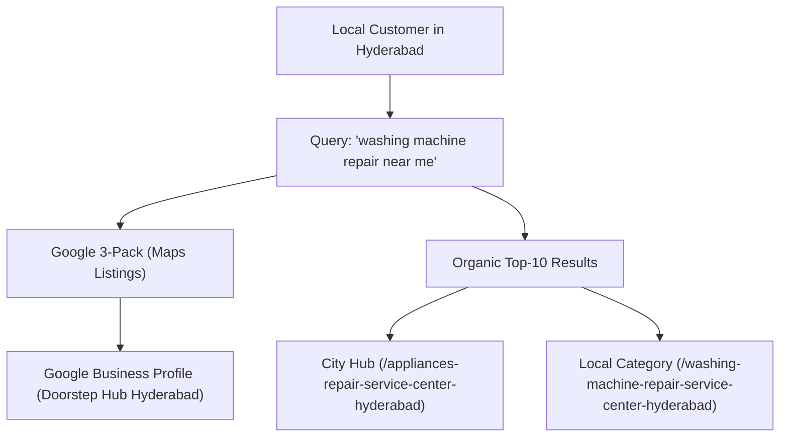

# Doorstep Hub — Local SEO & Multi-City Expansion Strategy

**Target Geography:** India  
**Priority Tier-1 Metros:** Hyderabad, Bengaluru, Chennai  
**Priority Tier-2 Growth Cities:** Vijayawada, Visakhapatnam, Guntur, Tirupati  

---

## 1. Local Search Ecosystem in India

In the Indian home services market, over 70% of high-intent search queries contain local modifiers (e.g., *“near me”*, *“in Madhapur”*, *“in Whitefield”*, *“in T Nagar”*).



---

## 2. City-Level Hierarchy Architecture

To dominate both Google Maps and organic search, Doorstep Hub must deploy a strict 3-tier local hierarchy:

```text
Tier 1: City Hub
└── https://doorstephub.com/appliances-repair-service-center-hyderabad
    │
    ├── Tier 2: Localized Service Category
    │   ├── https://doorstephub.com/ac-repair-service-center-hyderabad
    │   ├── https://doorstephub.com/washing-machine-repair-service-center-hyderabad
    │   └── https://doorstephub.com/refrigerator-repair-service-center-hyderabad
    │
    └── Tier 3: Locality / Micro-Market Clusters
        ├── Madhapur, Gachibowli, Kukatpally, Banjara Hills, Secunderabad
        └── Whitefield, Koramangala, Indiranagar, HSR Layout, Marathahalli
```

---

## 3. Google Business Profile (GBP) Integration

1. **NAP Consistency:** Ensure Name, Address, and Phone number on website city pages match GBP listings identically:
   - Doorstep Hub Private Limited
   - Primary Phone: `+91 8886688666`
2. **Local Landing Page Linkage:** Link each verified GBP listing directly to its corresponding city hub URL rather than the homepage.
3. **Local Customer Review Ingestion:** Dynamically display verified reviews from customers in that specific city on the landing page.
