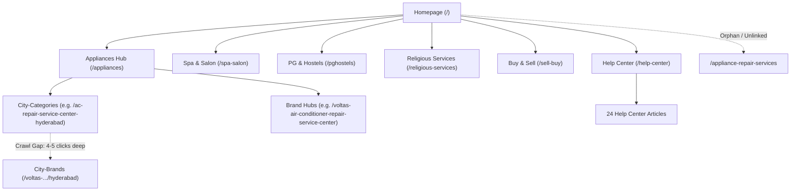

# Doorstep Hub — Internal Linking & Site Architecture Audit

---

## 1. Current Information Architecture & Crawl Depth

---

## 2. Critical Internal Linking Deficiencies

1. **Orphan / Disconnected Core Page:**
   - `/appliance-repair-services` exists in the filesystem and is actively linked from certain internal banners, but is excluded from primary header navigation and XML sitemaps.
2. **Excessive Crawl Depth on City-Brand Pages:**
   - 962 city-brand pages sit 4 to 5 clicks away from the homepage, making it difficult for Googlebot to discover and rank them without deep internal links.
3. **Missing Contextual Links in Help Center Articles:**
   - The 24 Help Center articles explain how to fix appliances (e.g. *“Why is my AC not cooling”*), but lack high-converting callout buttons linking to the relevant service booking page (`/ac-repair-services` or `/ac-repair-service-center-hyderabad`).

---

## 3. High-Impact Internal Linking Enhancements

1. **Add City Footer Matrix:** Expand the global footer with a clean, collapsable “Popular Service Locations” grid linking to the Top 7 operational cities.
2. **Contextual Booking CTAs in Articles:** In every Help Center article, inject an in-content conversion box:
   > *“Need professional AC repair in your city? Book verified Doorstep Hub technicians with a 90-day warranty.”*
