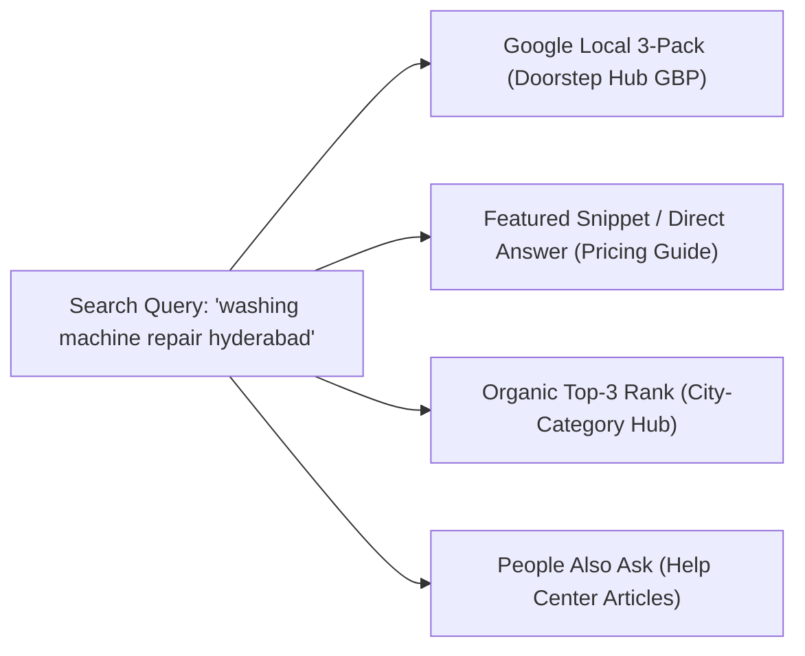

# Doorstep Hub — Competitor & Google Search Landscape Analysis

**Competitive Market:** India Local Services & On-Demand Booking  
**Primary Competitors:** Urban Company, Justdial, Sulekha, NoBroker (Hostels/Cleaning)  

---

## 1. Competitor Organic Landscape Overview

| Competitor | Domain Authority (Est.) | Primary Strength | Weakness / Exploitable Gap |
|---|---|---|---|
| **Urban Company** | High | Massive brand recall, slick mobile app | High commission rates, limited presence in tier-2/3 towns |
| **Justdial** | Very High | Massive directory footprint, billions of URLs | Aggressive lead selling, spammy user experience, poor pricing transparency |
| **Sulekha** | High | Deep regional presence in South India | Outdated UI, unverified lead distribution |
| **NoBroker** | High | Strong brand in PG, coliving and cleaning | Limited presence in appliance repair and religious ceremonies |
| **Doorstep Hub** | Growing | Multi-vertical convenience, upfront pricing, 90-day warranty | Low brand search volume, technical SEO debt, internal cannibalization |

---

## 2. Doorstep Hub SERP Opportunities

1. **Dominate High-Intent Tier-2 Cities:** Urban Company focuses heavily on Metros. Doorstep Hub can rapidly capture Top-3 rankings in Vijayawada, Visakhapatnam, Guntur, and Tirupati.
2. **Win "People Also Ask" via Help Center:** Help Center articles directly target high-volume troubleshooting questions that competitors ignore.
3. **Capture Long-Tail Appliance Brands:** Competitors rarely build dedicated pages for brands like Godrej, IFB, or Daikin in specific tier-2 towns.
