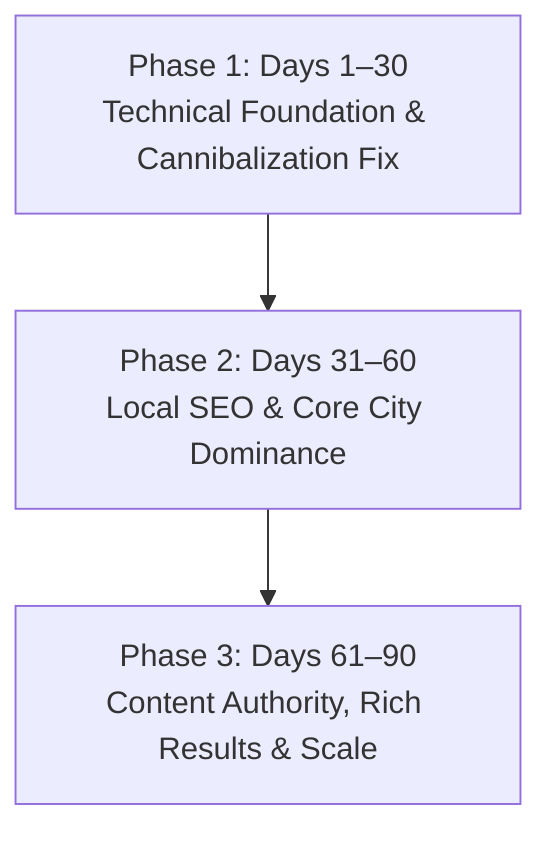

# Doorstep Hub — Google Top-10 Organic Ranking Roadmap

**Goal:** Establish sustainable, conversion-focused Top-10 Google search rankings for high-intent service and location keywords across India.

---

## 1. Strategic Phasing Framework

---

## 2. Detailed 90-Day Execution Roadmap

### Phase 1: Days 1–30 — Technical Remediation & Authority Consolidation
- **Consolidate Duplicate Landing Pages:** Implement 301 permanent redirect from `/appliance-repair-services` to `/appliances`.
- **Resolve Help Center vs Knowledge Base Split:** Redirect `/knowledge/*` to `/help-center/*` to combine duplicate page equity.
- **Fix Client-Side Redirects:** Replace `useEffect` redirects in `/pg-hostel` and `/religious` with HTTP 301/308 in `next.config.js`.
- **Remove Mobile Viewport Restriction:** Update `app/layout.js` to allow pinch-to-zoom.
- **Correct Root Layout Typo:** Fix *"Saloon"* -> *"Salon"* and *"Sytem"* -> *"System"* in root metadata.
- **Sitemap Clean-Up:** Remove `/blog` from `sitemap.xml` and include `/service-partner`, `/offers`, and `/app`.

### Phase 2: Days 31–60 — Multi-City Local SEO & Schema Expansion
- **Deploy `LocalBusiness` Schema:** Implement JSON-LD with geo-coordinates and opening hours on all 26 city hubs.
- **Pre-render City Landing Pages:** Migrate `repair-service/[citySlug]/page.js` to Server Components with `generateMetadata()` to eliminate the initial loading spinner.
- **Google Business Profile Alignment:** Align website city hubs with official Google Business Profiles in Hyderabad, Bengaluru, Chennai, and Vijayawada.
- **Locality Landing Pages:** Expand Top-3 metro hubs with micro-locality landing pages (e.g. Madhapur, Koramangala).

### Phase 3: Days 61–90 — Content Authority, Rich Results & Conversion Scaling
- **Author Bylines on Help Articles:** Attribute articles to certified senior appliance technicians.
- **Add BreadcrumbList JSON-LD:** Implement rich snippet breadcrumb navigation across all categories.
- **Thin Content Pruning:** Audit 962 city-brand pages; return 404 for unserviceable combinations to protect domain quality.
- **Contextual In-Article Booking CTAs:** Inject instant booking widgets inside top-ranking troubleshooting articles.
